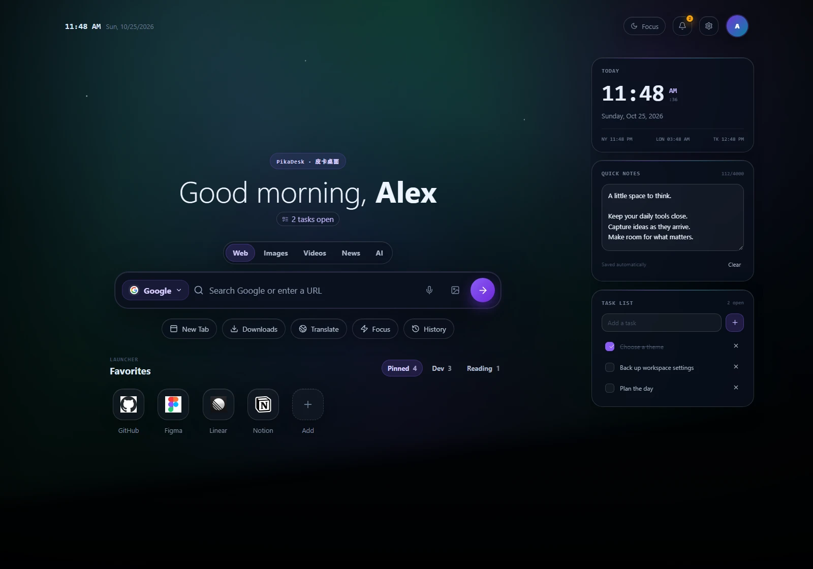
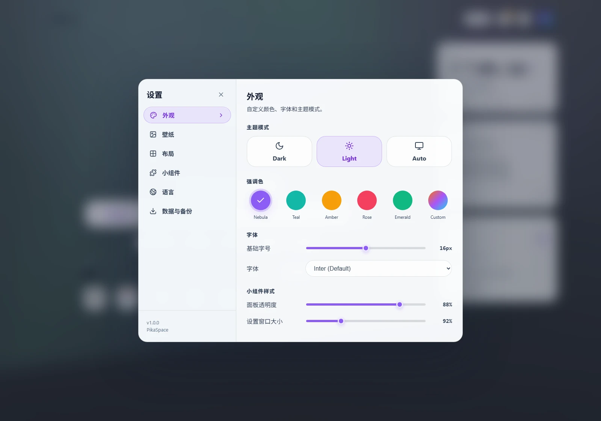

<div align="center">
  
  <h1>PikaDesk · 皮卡桌面</h1>
  <p><strong>Your Browser, Your Workspace.</strong></p>
  <p>A customizable Chrome new-tab dashboard for your tools, ideas, and everyday tasks.<br />把常用工具、灵感和日常安排，放进你的新标签页。</p>
  <p>
    <a href="public/manifest.json"></a>
    <a href="docs/RELEASE-NOTES.md"></a>
    <a href="docs/COMPANION.md"></a>
  </p>
  <p>
    <a href="#en">English</a> ·
    <a href="#zh">中文说明</a> ·
    <a href="#preview">Preview / 预览</a> ·
    <a href="#en-install">Install</a> / <a href="#zh-install">安装</a> ·
    <a href="https://github.com/MelonPika/PikaSpace/issues">Issues / 反馈</a>
  </p>
</div>

<a id="preview"></a>

## A workspace at a glance · 桌面预览



<p align="center"><sub>Actual extension captures from an isolated demo profile, with example notes and tasks.<br />实机截图，使用独立演示配置；便笺和任务为示例内容。</sub></p>

<details>
<summary>Appearance settings in Chinese · 查看中文外观设置</summary>



Switch themes, choose an accent, and adjust the workspace through the built-in settings.
通过内置设置切换明暗主题、选择强调色，调整自己的桌面。

</details>

---

<a id="en"></a>

## English

PikaDesk is a customizable Chrome new-tab dashboard with widgets, shortcuts, music controls, and a personalized workspace. Keep everyday links, quick notes, and tasks together, then switch to Focus when you want a quieter view.

The product is **PikaDesk · 皮卡桌面**; the GitHub repository is intentionally named **PikaSpace**. Windows desktop Chrome is the primary verified target.

[Features](#en-features) · [Install](#en-install) · [Windows companion](#en-companion) · [Privacy](#en-privacy) · [FAQ](#en-faq) · [Development](#development)

<a id="en-features"></a>

### Make a new tab your own

| Feature | What you can do |
| --- | --- |
| **Appearance** | Choose dark, light, or system theme; use a built-in or uploaded wallpaper; adjust accent colors, typography, panel opacity, and interface size. |
| **Widgets** | Enable and reorder the clock, notes, tasks, weather, news, music, and system widgets. Drag cards or use keyboard reordering. |
| **Shortcuts & search** | Organize favorites into groups, edit shortcuts, choose a search provider, and use keyboard-selected suggestions. |
| **Browser media** | Read and control accessible audio/video in Chrome tabs after granting optional site access. Play/pause works with HTML media; track controls depend on the player. |
| **Windows helper** | Add the Windows companion for desktop media and CPU, RAM, and fixed-disk information. |
| **Focus** | Hide widgets and favorites temporarily with Focus mode. |
| **Backups** | Export and import preferences, favorites, notes, tasks, profile, wallpaper, and widget order. Small preference collections can also use Chrome sync. |

Calendar is disabled in the current release. Its preserved source and dormant backup data are retained for compatibility.

<a id="en-install"></a>

### Install in Chrome

**Regular users do not need Node.js, npm, .NET, a local server, or the Windows companion.**

A packaged download is not currently published on [GitHub Releases](https://github.com/MelonPika/PikaSpace/releases). If you have a supplied **`PikaDesk-1.0.1.zip`**, follow these steps. If you have only the source code, [build a package first](#development). There is no published Chrome Web Store listing.

1. Extract `PikaDesk-1.0.1.zip` into a permanent folder on your computer.
2. Open `chrome://extensions/` in desktop Chrome.
3. Turn on **Developer mode**.
4. Click **Load unpacked** and select **`PikaDesk-1.0.1/extension`**, the folder containing `manifest.json`.
5. Open a new tab. Accept Chrome's new-tab change if prompted.

```text
PikaDesk-1.0.1/
└── extension/          ← Select this folder in Chrome
    ├── manifest.json
    ├── index.html
    └── …
```

Keep the extracted folder in place: Chrome loads the extension from it. GitHub's **Code → Download ZIP** gives you source code, which needs the build step.

For updates, settings migration, and browser media access, see the [installation guide](docs/INSTALL.md).

<a id="en-companion"></a>

### Optional Windows companion

Browser music works without the companion. Desktop apps, such as the Spotify desktop app, and system metrics use the optional Windows helper.

1. Load the Chrome extension first.
2. Run the separately supplied `PikaDesk-Companion-0.2.1-Setup-x64.exe`.
3. Keep **Connect automatically** selected, install, then refresh the dashboard. Manual pairing is available for unusual Chrome profiles.

The helper targets **Windows 10 version 2004 or later / Windows 11, x64**. Its runtime is included, it installs for the current user without administrator access, and Chrome starts it on demand. The current installer is unsigned. GPU readings are unavailable.

See [companion setup and verification](docs/COMPANION.md) or the [native-host developer guide](companion/README.md).

<a id="en-privacy"></a>

### Privacy & permissions

PikaDesk has no product account, advertising, analytics, or telemetry endpoint. Notes, tasks, profile images, wallpaper, and widget order stay on the device. Small preference collections may use Chrome sync, which Chrome controls.

Online features contact their respective providers for search suggestions, weather, news, and favicons. Voice search and media artwork can also involve external services. The [privacy documentation](docs/PRIVACY.md) explains each data flow.

| Permission | Why it is used |
| --- | --- |
| `storage` | Save settings and content, with optional sync for small preferences. |
| `scripting` + optional website access | Inspect and control browser media on sites you allow. Website access can be revoked in Chrome. |
| `nativeMessaging` | Connect to the optional local Windows companion. |
| `geolocation` | Find a weather location when requested; choosing a city also works. |
| Specific service hosts | Fetch weather, city results, search suggestions, and news. |

<a id="en-faq"></a>

### Questions & troubleshooting

<details>
<summary>How do I install if Chrome says the manifest is missing?</summary>

Choose the extracted **extension** folder, rather than its parent folder or the ZIP file. It must contain `manifest.json` and `index.html`. A source download needs to be built first. Follow the [installation steps](#en-install).

</details>

<details>
<summary>How do I update?</summary>

Export a settings backup, replace the contents of the existing extension folder with the new package's `extension` contents, then click **Reload** at `chrome://extensions/`. Keep the existing installation while updating. See the [update guide](docs/INSTALL.md).

</details>

<details>
<summary>Will I keep my settings after the rebrand?</summary>

Existing stable-key installations keep extension ID `abipfjhfejgjkhcpilkfdhbgaepljpki`. The manifest key, storage keys, backup format, and companion protocol are preserved.

Use **Settings → Data & Backup → Export settings** before reinstalling or changing profiles. Old 0.2.0 / 1.0.0 copies may have different IDs: export from the old copy and import into the new one. New exports use `pikadesk-settings.json`; existing `pikanav-settings.json` backups still import.

</details>

<details>
<summary>Why does desktop music need a companion?</summary>

The helper connects Chrome to Windows desktop media sessions and local system metrics through native messaging. It is optional for the dashboard and browser media. Existing helper registrations and saved pairing remain compatible. See [companion details](docs/COMPANION.md).

</details>

<details>
<summary>Why is my music not being detected?</summary>

Start playback in a tab in the **same Chrome profile**, then click **Enable browser media** in the Music widget and allow site access. Restricted pages and inaccessible players cannot be inspected. Previous/next stay disabled when a player does not expose supported controls.

For desktop music, install the optional helper and refresh PikaDesk. More checks are in [music without the companion](docs/INSTALL.md#music-without-the-companion) and the [companion troubleshooting guide](companion/README.md#troubleshooting).

</details>

---

<a id="zh"></a>

## 中文说明

皮卡桌面把新标签页变成一个可以随手调整的个人工作空间：常用网站、便笺、待办和音乐控制集中在一起，需要专注时，再一键收起小组件和快捷方式。

产品名称是 **PikaDesk · 皮卡桌面**，GitHub 仓库名 **PikaSpace** 保持不变。目前主要验证的平台是 Windows 桌面版 Chrome。

[主要功能](#zh-features) · [安装教程](#zh-install) · [桌面助手](#zh-companion) · [隐私与权限](#zh-privacy) · [常见问题](#zh-faq) · [开发说明](#development)

<a id="zh-features"></a>

### 按自己的习惯布置桌面

| 功能 | 可以做什么 |
| --- | --- |
| **外观** | 切换深色、浅色或跟随系统主题，选择内置壁纸或上传图片，调整强调色、字体、面板透明度和界面大小。 |
| **组件** | 按需开启时钟、便笺、待办、天气、新闻、音乐和系统信息；支持拖动排序，也可以用键盘调整顺序。 |
| **搜索与收藏** | 将常用网站分组，添加、编辑快捷方式，自选搜索引擎，并用键盘选择搜索建议。 |
| **音乐** | 授予可选的网站访问权限后，查看和控制 Chrome 标签页中的音视频；上一首、下一首是否可用取决于网页播放器。 |
| **桌面助手** | 安装 Windows 桌面助手后，连接桌面音乐，并查看 CPU、内存和本地磁盘信息。 |
| **专注** | 暂时收起小组件和收藏，让页面更清爽。 |
| **备份** | 导出、导入偏好设置、收藏、便笺、待办、个人资料、壁纸和组件顺序；小体积偏好数据也可使用 Chrome 同步。 |

当前版本未启用日历。相关源码与已有备份中的日历数据继续保留，以兼容旧版本。

<a id="zh-install"></a>

### 安装教程

**使用打包好的扩展，无需安装 Node.js、npm、.NET，也不需要启动本地服务或安装 Windows 桌面助手。**

目前 [GitHub Releases](https://github.com/MelonPika/PikaSpace/releases) 尚未发布安装包。拿到提供的 **`PikaDesk-1.0.1.zip`** 后，可按下面的步骤安装；如果手中只有源码，请先按[开发说明](#development)构建。当前也没有已发布的 Chrome 应用商店版本。

1. 将 `PikaDesk-1.0.1.zip` 解压到一个准备长期保留的文件夹。
2. 在桌面版 Chrome 地址栏输入 `chrome://extensions/`。
3. 打开右上角的 **开发者模式**。
4. 点击 **加载已解压的扩展程序**，选择 **`PikaDesk-1.0.1/extension`** 文件夹，确认里面有 `manifest.json`。
5. 新建一个标签页；如果 Chrome 提示确认新标签页变更，按提示接受即可。

```text
PikaDesk-1.0.1/
└── extension/          ← 在 Chrome 中选择这一层文件夹
    ├── manifest.json
    ├── index.html
    └── …
```

安装后请保留这个文件夹，Chrome 会继续从中读取文件。GitHub 的 **Code → Download ZIP** 下载的是源码，需要构建后才能加载。

更新、备份迁移和音乐权限设置请参阅[详细安装指南](docs/INSTALL.md)（英文）。

<a id="zh-companion"></a>

### 可选的 Windows 桌面助手

控制浏览器标签页中的音乐，不需要桌面助手。要连接 Spotify 等桌面应用，或查看系统信息，再按需安装即可。

1. 先在 Chrome 中加载皮卡桌面。
2. 运行单独提供的 `PikaDesk-Companion-0.2.1-Setup-x64.exe`。
3. 保持 **Connect automatically**（自动连接），完成安装后刷新桌面。特殊 Chrome 配置可以手动配对。

桌面助手面向 **Windows 10 2004 及以上 / Windows 11，x64**，已包含运行时，无需管理员权限，供当前 Windows 用户使用。Chrome 需要时才启动它。当前安装程序尚未签名，暂不提供 GPU 读数。

更多说明见[桌面助手安装与验证](docs/COMPANION.md)和[原生主机开发指南](companion/README.md)（英文）。

<a id="zh-privacy"></a>

### 隐私与权限

皮卡桌面没有产品账号、广告、分析统计或遥测服务。便笺、待办、头像、壁纸和组件顺序保存在设备上；小体积偏好数据可以使用由 Chrome 管理的同步功能。

搜索建议、天气、新闻和网站图标需要访问各自的服务商，语音搜索和媒体封面也可能涉及外部服务。具体的数据流向见[隐私说明](docs/PRIVACY.md)（英文）。

| 权限 | 用途 |
| --- | --- |
| `storage` | 保存设置和内容，并在适用时同步小体积偏好数据。 |
| `scripting` 与可选网站访问权限 | 在你允许的网站中读取、控制媒体；可以随时在 Chrome 中撤销网站访问权限。 |
| `nativeMessaging` | 与本机可选的 Windows 桌面助手通信。 |
| `geolocation` | 按需获取天气位置，也可以手动选择城市。 |
| 指定服务域名 | 获取天气、城市搜索结果、搜索建议和新闻。 |

<a id="zh-faq"></a>

### 常见问题与排查

<details>
<summary>加载时提示找不到 manifest，该选哪个文件夹？</summary>

请选择解压后的 **extension** 文件夹，里面应有 `manifest.json` 和 `index.html`，不要选择外层目录或 ZIP 文件。如果下载的是源码，需要先构建。可以对照[安装教程](#zh-install)中的目录结构检查。

</details>

<details>
<summary>如何更新到新版本？</summary>

先导出设置备份，再用新包的 `extension` 内容替换原扩展文件夹中的文件，然后在 `chrome://extensions/` 点击 **重新加载**。更新时保留现有安装即可。详见[安装指南](docs/INSTALL.md)。

</details>

<details>
<summary>改名以后，原来的设置还能保留吗？</summary>

使用稳定公钥的现有版本继续保持扩展 ID：`abipfjhfejgjkhcpilkfdhbgaepljpki`。此次改名保留了公钥、存储键、备份格式和桌面助手协议。

重新安装或切换 Chrome 配置前，请先到 **设置 → 数据与备份 → 导出设置**。旧版 0.2.0 / 1.0.0 可能使用不同 ID，需要从旧版导出，再在新版导入。新备份名为 `pikadesk-settings.json`，以前的 `pikanav-settings.json` 也能继续导入。

</details>

<details>
<summary>为什么桌面音乐需要另外安装助手？</summary>

桌面助手通过原生消息通信，让 Chrome 访问 Windows 桌面媒体会话和本地系统信息。使用皮卡桌面本身和浏览器网页音乐时不必安装。已有的助手注册信息和配对关系继续兼容，详见[桌面助手说明](docs/COMPANION.md)。

</details>

<details>
<summary>音乐没有被识别，怎么排查？</summary>

先在**同一 Chrome 配置**下的网页中开始播放，再点击音乐组件中的 **Enable browser media**，允许网站访问。Chrome 限制页面和无法访问的播放器不能被读取；播放器不支持时，上一首、下一首按钮会保持禁用。

如果播放的是桌面应用，请安装可选助手后刷新皮卡桌面。更多排查方法见[浏览器音乐说明](docs/INSTALL.md#music-without-the-companion)和[桌面助手故障排查](companion/README.md#troubleshooting)（英文）。

</details>

---

<a id="development"></a>

## Development · 开发说明

The dashboard build requires **Node.js 22.12+ and npm**. Companion development additionally requires Windows and a compatible .NET SDK; see the [companion build guide](docs/COMPANION.md#build).

桌面扩展构建需要 **Node.js 22.12+ 和 npm**。Windows 桌面助手的开发环境与工具要求，见[构建指南](docs/COMPANION.md#build)。

```sh
git clone https://github.com/MelonPika/PikaSpace.git
cd PikaSpace
npm ci
npm run dev
```

The dev server is a web preview. To use extension integrations, run `npm run build` and load `dist/` in Chrome.
开发服务器用于网页预览；需要测试扩展集成时，运行 `npm run build`，然后在 Chrome 中加载 `dist/`。

| Command | Purpose · 用途 |
| --- | --- |
| `npm run dev` | Start the web preview · 启动网页预览 |
| `npm run build` | Generate notices and build `dist/` · 生成依赖声明并构建扩展 |
| `npm run lint` | Check syntax, JSON, and production hazards · 检查语法、JSON 与生产代码风险 |
| `npm run typecheck` | Check active TypeScript code · 检查当前运行代码的类型 |
| `npm test` | Run regression tests, type checks, build, and extension validation · 回归测试、类型检查、构建与扩展验证 |
| `npm run test:browser` | Exercise real extension/media APIs in disposable Chromium profiles · 使用独立配置测试真实扩展与媒体 API |
| `npm run package` | Lint, test, and create portable / store-layout ZIPs · 检查、测试并生成便携包与商店格式包 |
| `npm run clean` | Remove generated build/test folders and Vite caches · 清理构建、验证目录与 Vite 缓存 |
| `npm run package:companion` | Build the optional Windows installer · 构建可选的 Windows 安装程序 |
| `npm run test:companion` | Test detection, install, pairing, upgrade, and uninstall in isolation · 独立测试检测、安装、配对、升级与卸载 |

Browser tests use real extension/media APIs and explicit fixtures for external services. Set `CHROME_PATH` when Chrome is installed elsewhere; reports and screenshots go to `.verification/`. Browser checks run separately from `npm run package` and are required for release acceptance. Companion and cleanup scripts use Windows PowerShell.

浏览器测试使用真实的扩展、媒体 API，以及明确的外部服务测试数据。Chrome 安装位置不同时可设置 `CHROME_PATH`；报告和截图保存在 `.verification/`。发布验收还需要单独运行浏览器测试。助手与清理脚本使用 Windows PowerShell。

### Package output · 打包产物

`npm run package` creates the following files locally. Generated releases are ignored by Git; building does not publish a release.

运行 `npm run package` 后会在本地生成以下内容；产物不纳入 Git，构建过程不会自动发布。

```text
releases/
├── PikaDesk-1.0.1/extension/
├── PikaDesk-1.0.1.zip
└── PikaDesk-1.0.1-chrome-web-store.zip
```

The store-layout ZIP puts `manifest.json` at its root for publisher review; it does not indicate store publication. The companion is packaged separately under `releases/companion/`.

商店格式 ZIP 将 `manifest.json` 放在根目录，供发布者准备提审，不代表已上架。桌面助手单独生成在 `releases/companion/`。

### Project map · 项目结构

| Path | Contents · 内容 |
| --- | --- |
| `src/` | Active dashboard UI, styles, and storage · 当前桌面界面、样式与存储 |
| `public/` | Manifest, background worker, media connector, and icons · 扩展清单、后台、媒体连接与图标 |
| `companion/` | Native host, installer, scripts, and diagnostic extension · 原生主机、安装程序、脚本与诊断扩展 |
| `scripts/` | Build, validation, packaging, and cleanup · 构建、验证、打包与清理 |
| `tests/` | Dashboard, media, storage, browser, and installer tests · 桌面、媒体、存储、浏览器与安装测试 |
| `docs/` | Installation, privacy, release, and companion guides · 安装、隐私、版本与助手文档 |
| `docs/assets/` | Real product screenshots and capture notes · 实机截图与拍摄说明 |
| `docs/archive/` | Historical source and verification evidence · 历史源码与验证记录 |
| `future-features/calendar/` | Disabled Calendar source preserved for future work · 保留的日历源码，当前未启用 |
| `releases/` | Generated extension packages and companion installers · 生成的扩展包与助手安装程序 |

`node_modules/`, `dist/`, `.verification/`, and `.cache/` are local dependency or generated folders. Cleanup keeps dependencies, historical archives, and every release version. To also remove cached installer tools, run:

以下命令会额外清理下载的安装工具缓存；普通清理会保留依赖、历史归档和所有版本的发布产物。

```powershell
powershell -NoProfile -ExecutionPolicy Bypass -File scripts/clean.ps1 -ToolCache
```

<a id="more-docs"></a>

### Further reading · 更多文档

| Guide | Details · 内容 |
| --- | --- |
| [Installation & media](docs/INSTALL.md) | Updates, backups, moving settings, and browser media · 更新、备份、迁移与浏览器音乐 |
| [Privacy](docs/PRIVACY.md) | Storage, permissions, and external data flows · 存储、权限与外部服务数据流 |
| [Companion](docs/COMPANION.md) / [Native protocol](companion/README.md) | Installer, packaging, detection, and native messaging · 安装、打包、检测与原生消息 |
| [Release notes](docs/RELEASE-NOTES.md) / [Store preparation](docs/STORE-PREPARATION.md) | Version changes and publisher checklist · 版本变化与发布准备 |
| [Historical audit](docs/RELEASE-AUDIT-1.0.md) / [Archives](docs/archive/README.md) | Previous release checks and preserved evidence · 历史验收与保留记录 |
| [Calendar source](future-features/calendar/README.md) | Deferred implementation and compatibility notes · 暂缓的实现与兼容说明 |

<a id="credits"></a>

## Credits · 致谢

Built with React, TypeScript, Vite, and Lucide. See [attributions](ATTRIBUTIONS.md), [runtime dependency notices](public/THIRD_PARTY_LICENSES.txt), and the [original dashboard design](https://www.figma.com/design/yCDgbKZjXOC3yYOOVFB6Uu/Customizable-New-Tab-Dashboard).

基于 React、TypeScript、Vite 与 Lucide 构建。第三方素材和依赖的许可说明见上方链接。

<div align="center">
  <p><strong>PikaDesk · 皮卡桌面</strong><br />Your Browser, Your Workspace.</p>
  <p>
    <a href="https://github.com/MelonPika/PikaSpace">Repository / 仓库</a> ·
    <a href="https://github.com/MelonPika/PikaSpace/releases">Releases / 版本</a> ·
    <a href="https://github.com/MelonPika/PikaSpace/issues">Issues / 反馈</a> ·
    <a href="docs/PRIVACY.md">Privacy / 隐私</a> ·
    <a href="#credits">Credits / 致谢</a> ·
    <a href="#en">↑ English</a> / <a href="#zh">中文</a>
  </p>
</div>
