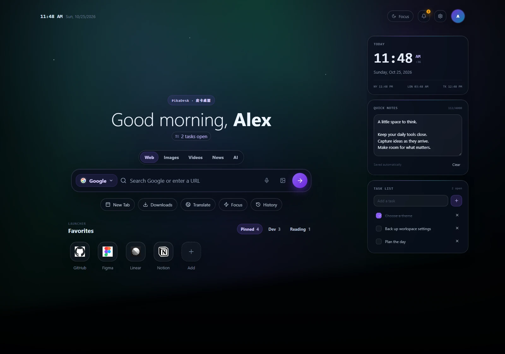

<a id="top"></a>

<div align="center">
  
  <h1>PikaDesk · 皮卡桌面</h1>
  <p><strong>Your Browser, Your Workspace.</strong></p>
  <p>
    <kbd>Chrome · Manifest V3</kbd>
    <kbd>小组件与快捷方式</kbd>
    <kbd>可选 Windows 桌面助手</kbd>
  </p>
  <p><a href="README.md">English</a> · <strong>简体中文</strong></p>
  <p>
    <a href="#installation">安装教程</a> ·
    <a href="#quick-start">快速上手</a> ·
    <a href="#features">主要功能</a> ·
    <a href="#troubleshooting">常见问题</a>
  </p>
</div>

把 Chrome 新标签页变成自己的工作空间，集中放置常用网站、便笺、待办和音乐控制。

<details>
<summary>🖼️ 桌面预览</summary>



扩展实机截图，便笺和任务为示例内容。[查看中文外观设置](docs/assets/settings-zh.webp)。

</details>

---

<a id="installation"></a>

## 📦 安装教程

**使用打包好的扩展，无需安装 Node.js、npm，也不需要启动本地服务或安装 Windows 桌面助手。**

目前 [GitHub Releases](https://github.com/MelonPika/PikaSpace/releases) 尚未发布安装包。拿到提供的 `PikaDesk-1.0.1.zip` 后，可按以下步骤安装；只有源码时，请先[完成构建](#development)。

1. 将 ZIP 解压到一个准备长期保留的文件夹。
2. 在桌面版 Chrome 中打开 `chrome://extensions/`。
3. 开启 **开发者模式**，点击 **加载已解压的扩展程序**。
4. 选择 **`PikaDesk-1.0.1/extension`** 文件夹，确认其中有 `manifest.json`。
5. 新建标签页；如 Chrome 提示确认新标签页变更，按提示接受即可。

安装后请保留解压目录。GitHub 的 **Code → Download ZIP** 下载的是源码，需要构建后才能加载。当前没有已发布的 Chrome 应用商店版本；主要验证的平台是 Windows 桌面版 Chrome。

目录结构和旧版迁移方法见[详细安装指南](docs/INSTALL.md)（英文）。

<a id="quick-start"></a>

## 🚀 快速上手

1. 新建标签页，点击 **设置** 齿轮。
2. 在 **外观** 和 **壁纸** 中选择主题、强调色和背景。
3. 在 **小组件** 中开启需要的卡片，拖动排序，或使用 **Alt + 上/下方向键**。
4. 点击 **+** 添加常用网站，右键快捷方式可编辑。
5. 控制网页音乐时，点击 **Enable browser media** 并允许网站访问。

设置会自动保存。开启 **专注模式** 可暂时收起小组件和收藏。

<a id="features"></a>

## ✨ 主要功能

| 功能 | 说明 |
| --- | --- |
| **外观** | 深色、浅色或跟随系统主题；内置和自定义壁纸；颜色、字体、透明度与界面大小。 |
| **小组件** | 时钟、便笺、待办、天气、新闻、音乐和系统信息，可调整顺序与显示状态。 |
| **搜索与收藏** | 多种搜索引擎、键盘选择搜索建议，以及分组管理常用网站。 |
| **网页音乐** | 查看、控制 Chrome 标签页中可访问的音视频；上一首、下一首是否可用取决于播放器。 |
| **桌面集成** | 按需连接 Windows 桌面音乐，查看 CPU、内存和本地磁盘信息。 |
| **备份** | 导出、导入设置、收藏、组件内容、个人资料、壁纸与组件顺序。 |

当前版本未启用日历。相关源码和已有备份中的日历数据继续保留，以兼容旧版本。

<a id="windows-companion"></a>

## 🪟 可选的 Windows 桌面助手

浏览器网页音乐不需要桌面助手。要连接 Spotify 等桌面应用或查看系统信息时，再按需安装即可。

运行单独提供的 `PikaDesk-Companion-0.2.1-Setup-x64.exe`，保持 **Connect automatically**（自动连接），安装后刷新桌面。

助手面向 **Windows 10 2004 及以上 / Windows 11，x64**，已包含运行时，无需管理员权限，由 Chrome 按需启动。当前安装程序尚未签名，暂不提供 GPU 读数。

更多说明见[安装与排查指南](docs/COMPANION.md)和[原生主机文档](companion/README.md)（英文）。

<a id="data-and-backups"></a>

## 💾 数据与备份

便笺、待办、头像、壁纸和组件顺序保存在设备上。小体积偏好数据可以使用 Chrome 同步，是否同步由浏览器账号设置决定。

重新安装或切换 Chrome 配置前，请到 **设置 → 数据与备份** 导出备份。新备份名为 `pikadesk-settings.json`，以前的 `pikanav-settings.json` 也能继续导入。

搜索建议、天气、新闻、网站图标、语音搜索和媒体封面可能访问外部服务。皮卡桌面没有产品账号、广告、分析统计或遥测服务。具体数据流向见[隐私与权限说明](docs/PRIVACY.md)（英文）。

<a id="updating"></a>

## 🔄 更新方法

先导出备份，再用新包中 `extension` 的内容替换原扩展目录的文件，到 `chrome://extensions/` 点击 **重新加载**，然后新建标签页。

使用稳定公钥的现有版本继续保持 ID：`abipfjhfejgjkhcpilkfdhbgaepljpki`。公钥、存储键、备份格式和桌面助手协议均保持兼容。旧版 0.2.0 / 1.0.0 可能使用不同 ID，需要先从旧版导出，再在新版导入。

<a id="troubleshooting"></a>

## 🛠️ 常见问题

<details>
<summary>展开查看常见问题</summary>

**加载时提示找不到 manifest。**

请选择解压后的 **extension** 文件夹，其中应有 `manifest.json` 和 `index.html`。源码 ZIP 需要先构建。

**网页音乐没有被识别。**

先在同一 Chrome 配置下的网页中开始播放，再启用浏览器媒体并允许网站访问。Chrome 限制页面和无法访问的播放器不能被读取；播放器不支持时，上一首、下一首会保持禁用。

**为什么桌面音乐需要助手？**

助手通过原生消息通信，让 Chrome 访问 Windows 桌面媒体会话和系统信息。使用皮卡桌面本身及浏览器音乐时不必安装。

**桌面助手无法连接。**

重新运行安装程序，使用 **Connect automatically**，然后刷新皮卡桌面。特殊 Chrome 配置可以手动配对。更多方法见[助手故障排查](companion/README.md#troubleshooting)（英文）。

</details>

遇到问题或有建议时，可以[提交 Issue](https://github.com/MelonPika/PikaSpace/issues)，附上浏览器版本、复现步骤和截图。

<a id="development"></a>

## 🧑‍💻 开发说明

需要 **Node.js 22.12+ 和 npm**。

```sh
npm ci
npm run build
```

在 Chrome 中加载 `dist/` 可测试扩展集成。`npm run dev` 用于网页预览，`npm run package` 生成本地 ZIP，`npm test` 执行回归测试、类型检查、构建与扩展清单验证。

完整命令、浏览器测试、打包、项目结构、清理和助手开发说明见[开发指南](docs/DEVELOPMENT.md)。另见[版本说明](docs/RELEASE-NOTES.md)、[商店发布准备](docs/STORE-PREPARATION.md)和[历史归档](docs/archive/README.md)（英文）。

<a id="credits"></a>

## 致谢

基于 React、TypeScript、Vite 与 Lucide 构建。第三方素材与依赖说明见[致谢与归属](ATTRIBUTIONS.md)、[依赖许可声明](public/THIRD_PARTY_LICENSES.txt)和[原始界面设计](https://www.figma.com/design/yCDgbKZjXOC3yYOOVFB6Uu/Customizable-New-Tab-Dashboard)。

<p align="center">
  <a href="https://github.com/MelonPika/PikaSpace">仓库</a> ·
  <a href="https://github.com/MelonPika/PikaSpace/releases">版本</a> ·
  <a href="docs/PRIVACY.md">隐私</a> ·
  <a href="#top">↑ 回到顶部</a>
</p>
